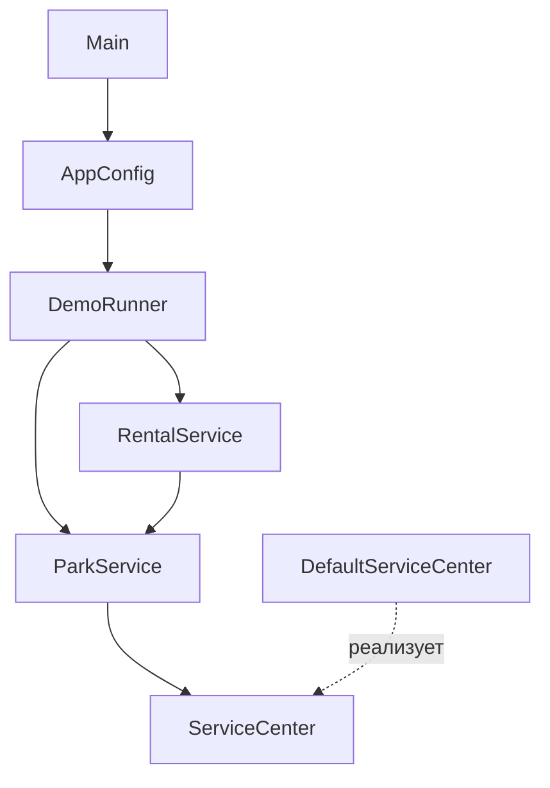

# ВышКат — учёт парка кикшеринга

Консольное приложение на Java 

## Запуск

Из корня проекта: `./gradlew run`.

## Возможности и трактовки

- Приём транспорта через техосмотр: принятое средство добавляется на баланс,
  отклонённое — нет.
- Учёт транспорта и вещей по уникальным инвентарным номерам.
- Подсчёт количества объектов и суточного энергопотребления.
- Список прокатной техники с простотой от 6/10 для новичков.
- Управление арендой: выдача принятого транспорта клиенту, запрет повторной
  выдачи занятого транспорта, возврат и сохранение истории с длительностью.
- Демонстрация сценариев при запуске Main.

«Для новичка» трактуется как характеристика транспорта по шкале 1–10

`InventoryItem` задаёт название и инвентарный номер. `EnergyConsumer` описывает
суточный расход энергии. `RentalVehicle` задаёт поведение прокатной техники и
порог новичка. Самокат, велосипед, электровелосипед, шлем и зарядная станция
реализуют нужные интерфейсы. `Rental` хранит клиента, транспорт, время начала и
возврата.

## Структура приложения

Сплошные стрелки показывают использование компонентов, пунктирная — реализацию
интерфейса.

`AppConfig` связывает компоненты через Spring. `ParkService` отвечает за
инвентарь и техосмотр, `RentalService` — за начало и завершение аренды и запрет
повторной выдачи занятого транспорта. Время начала и возврата передаётся явно;
тариф не рассчитывается, так как его правила не заданы.

## SOLID

- S — ParkService управляет составом парка; RentalService ведёт жизненный
  цикл аренды; DefaultServiceCenter принимает решение по техосмотру; DemoRunner
  отвечает за консольный вывод. У этих классов разные причины для изменения.
- O — ParkService считает энергию через EnergyConsumer, а новичковую технику
  выбирает через RentalVehicle. Новый вид транспорта можно добавить отдельным
  классом, реализовав нужные интерфейсы, не меняя логику отчётов.
- L — Scooter, Bicycle и ElectricBicycle используются через RentalVehicle:
  каждый тип предоставляет название, инвентарный номер, оценку простоты и
  результат техосмотра. При этом обычный Bicycle не обязан изображать
  потребителя энергии.
- I — возможности вынесены в небольшие интерфейсы: InventoryItem отвечает
  за инвентарный учёт, EnergyConsumer — за расход, RentalVehicle — за прокат
  и простоту. Например, Helmet реализует только InventoryItem.
- D — ParkService зависит от ServiceCenter, а не от DefaultServiceCenter.
  В ParkServiceTest передаётся тестовая реализация.

## Ответы на обязательные вопросы

- Какой принцип применён наиболее явно: D — ParkService зависит от
  ServiceCenter; в ParkServiceTest передаётся тестовая реализация.
- Какой принцип сознательно ограничен: S — ParkService объединяет
  операции учёта и отчёты. Для одного небольшого парка это приемлемо и позволяет
  не вводить отдельный класс на каждый отчёт.
- Что произойдёт при расширении: новый вид транспорта добавляется
  реализацией нужных интерфейсов без правки отчётов и RentalService.
  Сотрудник — отдельная модель и не реализует InventoryItem, поэтому не
  попадает на баланс.
  Для склада запчастей нужны
  отдельная модель и правила учёта; текущая логика парка останется прежней.
- Какой тест проверяет техосмотр и как подменяется зависимость:
  ParkServiceTest проверяет принятие и отклонение, передавая тестовый
  ServiceCenter через конструктор ParkService. DefaultServiceCenterTest проверяет штатное
  решение сервиса.
- Что сделал ИИ:
  В основном использовал для тестов, JaCoCo, Checkstyle. Также просил сравнить репозиторий нашего семинариста
  с моим проектом и подметить ошибки, наблюдения, улучшения, а также сделать красивое офрмление README например
  стрктуру приложения. Я в свою очередь сдедал структуру классов, интерфейсов, ключевой функционал и логику работы 
  , а также сборку и настройку приложения. Проводил ревью кода и вносил правки и доработки в сгенеренный код. 
  

## Тесты и стиль

JaCoCo показывает 95% покрытия строк при пороге 70%. HTML-отчёт:
`build/reports/jacoco/test/html/index.html` (сгенерировать: `./gradlew jacocoTestReport`).

Checkstyle 14.1.0 использует Sun-набор; правила `JavadocPackage` и
`JavadocVariable` отключены.

*ВК означает «ВышКат»: транспорту присвоены номера
ВК-001, ВК-002 и ВК-003.
